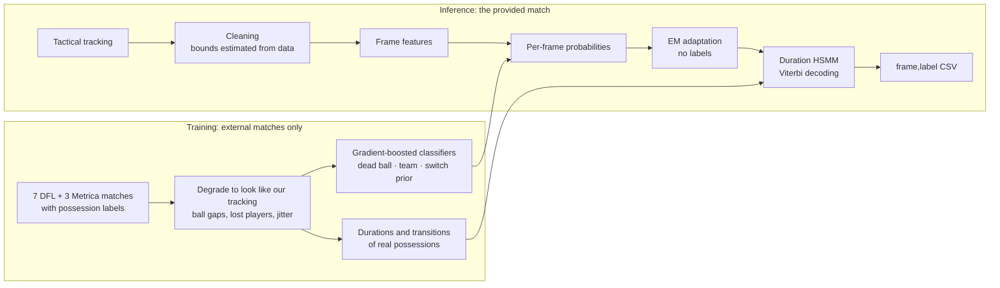
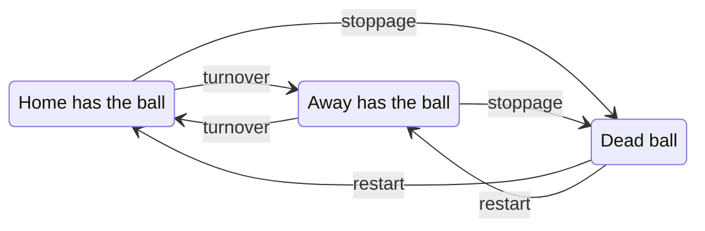

# From dots to possessions

**Team Graciencs · More Than A Hack 2027 · Initial Challenge**


Who has the ball, frame by frame, in FC Barcelona vs Athletic Club? The only input is automatic tracking:
22 players and a ball as dots, 25 times a second, with the ball missing on 41 % of the graded frames. This
repository turns those dots into one label per video frame: `H` home, `A` away, `D` dead ball, `X` not graded.

The model never saw a label of this match. It learns from other matches, made as noisy as ours on purpose,
and its parameters are estimated from data or chosen by cross-validation on those other matches.

## How it works



1. **Clean.** Remove ball spikes and impossible player jumps, fill short ball gaps, merge duplicate objects.
   Every bound is estimated from data.
2. **Describe each frame.** Ball kinematics, nearest players per team, touches, team shape, and how far
   players stand beyond the pitch lines. No feature depends on a tracking slot keeping its identity.
3. **Classify.** A dead-ball model says whether play is stopped, using player movement only, so a missing
   ball is not read as a stoppage; a second stage refines it with temporal context. A team model says who
   has the ball, and a switch prior scores how likely a change of possession is near each frame.
4. **Adapt.** Expectation-maximisation re-estimates the dead-ball prior and the ball evidence on the match
   itself, without labels.
5. **Decode.** The ranking metric scores whole possessions, so flicker is expensive. A hidden semi-Markov
   model with learned possession durations turns the frame probabilities into clean spells. Graded frames
   before each kickoff published in the official `games.py` are written as `D`.



Each state lasts for a duration drawn from what real possessions and stoppages look like in the external
matches. That is what keeps a deflection from becoming a possession.

## Results on matches the model never saw

Leave-one-match-out: each match is scored by a model trained without it, with decoder settings chosen on the
other matches only. `spellF1` is the ranking metric (possessions matched by temporal overlap).

| Held-out data | Matches | spellF1 | macroF1 |
|---|---:|---:|---:|
| Metrica sample games | 3 | 0.78 | 0.92 |
| DFL Bundesliga | 7 | 0.59 | 0.88 |
| SkillCorner (never trained on, no dead-ball labels) | 20 | 0.32 | |

These are estimates on other providers' data, degraded to resemble ours. They are not a score on the
provided match. Per-match numbers, confidence intervals and what did not work are in the
[full report](docs/technical_document.md).

## Reproduce the submitted file

With Docker and the match data from the official `DATA.md`:

```bash
scripts/reproduce_docker.sh /path/to/data outputs
```

The script builds a pinned image, runs the committed model on the two tactical tracking files and prints the
sha256 of the CSV, which must be

```
234c1366efa2d4a95a23eb0e8c9944af5ee6e6520da5e289f6204a14e665297b
```

It takes about three to four minutes plus the image build and needs no network once the image is built. The
same bytes come out on linux/arm64, on emulated linux/amd64 and natively on macOS arm64.

Without Docker:

```bash
uv sync --frozen
MTAH_DATA_DIR=/path/to/data .venv/bin/python -m possession.run --config configs/learned.json --out team.csv
```

Only the Docker output is the submission. Details, environment variables and retraining:
[docs/USAGE.md](docs/USAGE.md).

## Rules we held ourselves to

- **No labels of the provided match.** Training and tuning use external matches only.
- **No hand-set constants** in the submitted method. Each parameter and its origin is listed in
  [docs/PARAMETERS.md](docs/PARAMETERS.md).
- **No video.** The submitted method reads the two tactical tracking files and nothing else.
- **No match data in this repository.** Only code, model weights and aggregate scores.

The full account is in [docs/COMPLIANCE.md](docs/COMPLIANCE.md).

## What is in the repository

| Path | What |
|---|---|
| `src/possession/` | The pipeline: cleaning, features, classifiers, decoder, and the tools around them |
| `models/learned/` | The submitted model and its selection report |
| `configs/` | Run configurations; `learned.json` is the submission |
| `scripts/` | `reproduce_docker.sh` and the logged training runs |
| `tests/` | Test suite (`.venv/bin/python -m pytest`) |
| `docs/` | The submitted technical document, the full report and the records behind every decision |

Documentation:

- [Short technical document](docs/Graciencs.md), also as [PDF](docs/Graciencs.pdf): the submitted document,
  three pages.
- [Full report](docs/technical_document.md), also as [PDF](docs/technical_document.pdf): method, data,
  validation, limitations, in detail.
- [Usage reference](docs/USAGE.md): setup, every command, retraining.
- [Parameters](docs/PARAMETERS.md): every parameter and where its value comes from.
- [Dead-ball study](docs/DEADBALL.md): each model decision with its held-out numbers.
- [External data](docs/EXTERNAL.md): datasets, licences, how labels were derived.
- [Compliance](docs/COMPLIANCE.md), [ground-truth semantics](docs/GT_SEMANTICS.md) and the
  [original plan](docs/PLAN.md).

Both PDFs are rendered from their Markdown with pandoc 3.10 and WeasyPrint 69 (replace `Graciencs` with
`technical_document` for the full report):

```bash
pandoc docs/Graciencs.md -f markdown+pipe_tables+fenced_code_blocks -t html5 -s --embed-resources \
  --css docs/technical_document.css -o td.html && weasyprint td.html docs/Graciencs.pdf
```

## Licence and data credits

Code and documentation: MIT, see `LICENSE`. The official `games.py`, scorer and validator are vendored
unmodified in `src/possession/vendor/` and keep their own licence. The match data and the external datasets
are not included and keep their own terms.

- **DFL** (training and validation): Bassek, M., Rein, R., Weber, H., Memmert, D. (2025). An integrated
  dataset of spatiotemporal and event data in elite soccer. Scientific Data 12, 195,
  https://doi.org/10.1038/s41597-025-04505-y. Data © DFL Deutsche Fußball Liga, CC BY 4.0
  (https://creativecommons.org/licenses/by/4.0/), https://doi.org/10.6084/m9.figshare.28196177. We trained
  on a degraded copy (ball gaps, player thinning, duplicates, jitter); only model weights and aggregate
  scores are published.
- **Metrica Sports** (training and validation): sample data, Sample_Game_1 to 3,
  https://github.com/metrica-sports/sample-data. We acknowledge Metrica Sports as the source, as the README
  of that repository asks; it has no licence file.
- **SkillCorner** (evaluation only): open data, © 2020 SkillCorner, MIT licence,
  https://github.com/SkillCorner/opendata.
